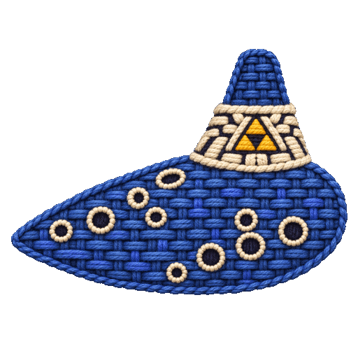

<p align="center">
  
</p>

<h1 align="center">Ocarina Hero</h1>

<p align="center">
  <em>Learn a melody on the ocarina, be the hylian rockstar.</em><br />
  <a href="https://ocarinahero.app/"><strong>Play it in your browser →</strong></a>
</p>

---

Ocarina Hero turns songs into button tabs for the ocarina of
*The Legend of Zelda: Ocarina of Time*, then teaches them through an embroidered,
tapestry-style interface that works on phones and desktop.

- **Songbook**: curated game, anime, film, pop and classic melodies, filterable by category and universe, with the songs the game teaches first, saved favourites and the song you last opened.
- **Lessons**: listen to or practice each passage on a button staff, at 100%, 75% or 50% speed. Completed songs and your best combo are kept in the browser.
- **Free play**: improvise on the on-screen pad or the keyboard.
- **Workshop**: import a MIDI file, or a short fragment of a recording, as a playable tab. The melody is found in your browser; it is most accurate with a single instrument or voice.

## Run locally

```bash
npm install
npm run dev   # http://localhost:5173
```

The most precise analysis of songs with accompaniment uses local models that are not available in the
online version: run `npm run setup:melody` first ([details](docs/local-melody.md)).

## Learn more

[Project notes](docs/project-notes.md) · [Product objective](docs/objetivo.md) · [Design system](docs/design-system.md)

---

<p align="center">
  If Ocarina Hero helps you play, consider leaving a ⭐ on the repository.<br />
  <sub>Fan project, not affiliated with or endorsed by Nintendo.</sub>
</p>
